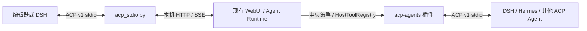

# ACP v1 双向接入

本实现以本地 DeepSeek Harness `dsh-acp` / `dsh-subagent-acp` 的公开 ACP v1 接口为互通基准，使用官方 Python SDK。外部协议不增加私有方法或要求 `_meta`；客户端按 initialize 返回的能力决定调用范围。

## 所有者与调用链

现有后端继续拥有会话、运行、持久化和工具审批。stdio 进程只拥有当前连接激活的会话句柄、prompt、配置和协议映射。连接关闭时使用本连接记录的 run_id 请求取消、等待 prompt 结束，再释放会话 MCP；持久会话保留。同一会话按单控制端使用，不同会话可并行。普通请求日志只写 stderr。

## 服务端标准接口

| 接口 | 行为 |
| --- | --- |
| initialize | ACP v1；声明 list/resume/close、HTTP MCP；不声明图片、音频、embeddedContext |
| authenticate | 本机可信 stdio 控制器，无额外认证 |
| session/new | 验证绝对 cwd，创建原生会话，挂载请求内的 stdio/HTTP MCP 后才返回 |
| session/list | 持久根会话、cwd 过滤、游标分页 |
| session/resume | 验证会话存在且 cwd 相同，恢复配置并重连本次请求的 MCP；不回放历史，不在缺失时新建 |
| session/close | 停止本连接的 prompt，等待完成，释放本会话 MCP；持久记录可再次 resume |
| session/prompt | 文本和 resource_link；每会话一个在途请求，不同会话独立 |
| session/set_config_option | model / reasoning_effort；返回完整配置；运行中的修改在下一轮使用 |
| session/cancel | 取消本连接发起的当前 prompt；未知 session 为 no-op |
| session/update | 已提交的助手文本、思考、通用工具生命周期及配置变更 |
| session/request_permission | 映射现有摘要绑定审批；只提供 allow_once/reject_once |

与 DSH 一致，首版不提供 session/load、fork、delete、modes、commands、plans、客户端文件操作、客户端终端和 additionalDirectories。SDK 支持这些方法不等于本服务声明支持。客户端提供的 MCP 只挂载到指定会话；连接、初始化或发现失败必须回滚，不写全局 mcp_config。SSE / ACP MCP transport 拒绝。

## 调用外部 Agent

在插件设置启用 ACP Agents 并配置 agents_json。模型只能选择管理员配置的 target id，不能指定可执行程序或环境。acp_agents 列举目标，acp_task 以当前会话工作目录启动一个全新的 ACP 子进程、initialize/new/prompt，汇总 agent_message_chunk。父对话、工具集、persona 不自动继承。父取消和超时发送 session/cancel，随后关闭 stdin 并有界回收进程树。stderr 不进入模型结果。

子进程仅继承最小系统环境；env_refs 明确选择环境中的凭据。默认拒绝子 Agent 的权限请求；管理员可为目标设置 permission=allow，此时只选择 allow_once，绝不隐式选择长期授权。子进程可访问其操作系统权限允许的文件；工作目录和进程分离不提供硬沙箱。调用工具仍经过仓库中央审批。

## 验收

使用官方 SDK 和无密钥假 Agent 验证真实 stdio 双向握手、文本结果、权限、取消、超时和进程清理。使用 HTTP 假后端验证服务端能力、持久恢复无回放、未知恢复拒绝、同会话重入拒绝、配置下一轮生效、工具事件顺序及 session MCP 隔离。真实模型和本地 DSH 依赖齐备时另做实际互通，不把假后端检查称为真实模型验证。

## 本地验证记录（2026-10-25）

- 官方 Python SDK 0.12.1 与 DSH 使用的 TypeScript SDK 1.4.0 双向真实 stdio 检查通过。Python SDK 内部仍将 list/resume/close 放在 use_unstable_protocol 开关后；服务端启用此 SDK 开关，外部仍使用标准 ACP v1 方法与字段。
- ACP 新增测试及 MCP、插件宿主、依赖检查相关回归共 70 项通过；编译检查和 diff whitespace 检查通过。
- 本地 DSH CLI 的实际进程在 initialize 阶段超时。单独运行该检出的官方 ACP keyless 测试，也在启动前因 `apps/cli/tests/profiles/acp/cordis.yml` 不是顶层 YAML 数组而失败；这份文件当前为一个相对路径字符串。尚未证明实际 DSH 任务端到端可用，也未调用真实模型。
- 对外服务端当前需要已运行的本机后端；图片、音频、历史回放及其他未声明能力继续按 capability 拒绝。
