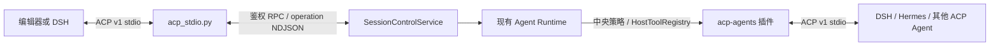
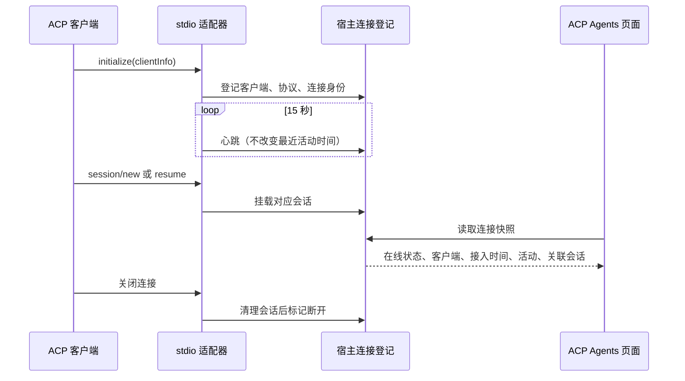

# ACP v1 双向接入

本实现以本地 DeepSeek Harness `dsh-acp` / `dsh-subagent-acp` 的公开 ACP v1 接口为互通基准，使用官方 Python SDK。外部协议不增加私有方法或要求 `_meta`；客户端按 initialize 返回的能力决定调用范围。

## 所有者与调用链



现有后端继续拥有会话、运行、持久化和工具审批。stdio 进程只拥有当前连接激活的会话句柄、prompt、配置和协议映射。prompt 通过公共入箱接收，流与取消绑定具体 operation，忙碌会话排队。连接关闭时取消本连接的 operation、等待 prompt 结束，再释放会话 MCP；持久会话保留。同一会话按单控制端使用，不同会话可并行。普通请求日志只写 stderr。

独立启动 stdio 前，使用同一系统用户运行 `app/agent-session-control.py auth login` 完成后端登录。适配器复用按地址保存的控制凭据；Agent 宿主可注入受限任务令牌。有任务标记而令牌缺失时拒绝，不回退个人身份。新建、配置修改、审批及 MCP 配置仍分别检查能力；空 MCP 请求只检查会话访问，非空请求另需 `session.mcp.configure`。MCP 所有者由真实身份和连接 ID 共同绑定。

## 从命令行调用并接收实际结果

终端工具可以运行仓库内的 ACP 客户端入口；进程会等待当前 prompt 终态，不会在创建会话后提前退出：

```powershell
.\python\python.exe app/acp_call.py --cwd "D:\path\to\workspace" --prompt "请完成这个任务" --result-file "D:\path\to\result.json"
```

已有会话加 `--session-id <ID>`，按标准 `session/resume` 继续；省略则新建。长文本可使用 `--prompt-file <UTF-8 文件>` 或 `--stdin`。`--timeout` 默认 600 秒。凭据沿用上面的个人登录或宿主任务令牌，不自动登录或另起后端；默认拒绝 ACP 权限请求。

stdout 为逐行 JSON：`started` 仅代表会话已激活；`progress` 是普通回复文本；`completed` 才是调用结果，包含 request_id、session_id、session_action、status、output、stop_reason、截断和权限标记。成功退出码为 0，任务失败/取消/未正常结束为 1，参数或登录错误为 2，超时为 7。结果文件只写终态，并原子替换；失败和超时保留已收集文本，错误仅返回分类。连接释放后仍可继续同一持久会话，关闭句柄失败不会覆盖已收到的成功任务结果。

调用端必须持续等待读取终端结果：终端工具返回进程 ID 时，应继续等待该进程，直到 `completed`。ACP 不负责唤醒已经结束的 Codex 聊天，也不会把之后从网页发送的任意轮次自动回送给先前客户端；那需要调用端另行实现结果收件和唤醒机制。临时 `.analysis` 状态文件不能作为在线或回传成功的凭据。

适配器读取持久 operation 结果时，HTTP 断开、30 秒读超时或 502/503/504 最多重连 3 次，使用原 operation 和最后事件游标，过滤重复事件，绝不重新提交 prompt。读取最终执行收据作为回复兜底，防止空 final 事件吞掉已有结果；撤销身份或非法事件直接失败。该恢复仅覆盖 HTTP 事件流，不能让已经退出的 ACP 客户端自动复活。

2026-10-31 实际回传验证：原生会话 `a1fb9afe-2136-5236-a403-6ee616f51bd1` 新建和随后 resume 两次均通过 ACP 返回 `ACP_RETURN_20261031_OK`；第二轮没有重传该字符串。测试另外覆盖结果流断线后接续、去重、收据兜底、重试上限、身份撤销、超时保留部分回复、关闭失败与终端入口。

## 服务端标准接口

| 接口 | 行为 |
| --- | --- |
| initialize | ACP v1；声明 list/resume/close、HTTP MCP；不声明图片、音频、embeddedContext |
| authenticate | 不增加 ACP 登录交互；HTTP 后端凭据在启动环境或个人登录存储中提供 |
| session/new | 验证绝对 cwd，创建原生会话，挂载请求内的 stdio/HTTP MCP 后才返回 |
| session/list | 持久根会话、cwd 过滤、游标分页 |
| session/resume | 验证会话存在且 cwd 相同，恢复配置并重连本次请求的 MCP；不回放历史，不在缺失时新建 |
| session/close | 停止本连接的 prompt，等待完成，释放本会话 MCP；持久记录可再次 resume |
| session/prompt | 文本和 resource_link；每会话一个在途请求，不同会话独立 |
| session/set_config_option | model / reasoning_effort；返回完整配置；运行中的修改在下一轮使用 |
| session/cancel | 取消本连接发起的当前 prompt；未知 session 为 no-op |
| session/update | 助手文本、通用工具生命周期及配置变更；不转发内部推理 |
| session/request_permission | 映射现有摘要绑定审批；只提供 allow_once/reject_once |

与 DSH 一致，首版不提供 session/load、fork、delete、modes、commands、plans、客户端文件操作、客户端终端和 additionalDirectories。SDK 支持这些方法不等于本服务声明支持。客户端提供的 MCP 只挂载到指定会话；连接、初始化或发现失败必须回滚，不写全局 mcp_config。SSE / ACP MCP transport 拒绝。

## 调用外部 Agent

在插件设置启用 ACP Agents 并配置 agents_json。模型只能选择管理员配置的 target id，不能指定可执行程序或环境。acp_agents 列举目标，acp_task 以当前会话工作目录启动一个全新的 ACP 子进程、initialize/new/prompt，汇总 agent_message_chunk。父对话、工具集、persona 不自动继承。父取消和超时发送 session/cancel，随后关闭 stdin 并有界回收进程树。stderr 不进入模型结果。

子进程仅继承最小系统环境；env_refs 明确选择环境中的凭据。默认拒绝子 Agent 的权限请求；管理员可为目标设置 permission=allow，此时只选择 allow_once，绝不隐式选择长期授权。子进程可访问其操作系统权限允许的文件；工作目录和进程分离不提供硬沙箱。调用工具仍经过仓库中央审批。

目标可显式配置 `session_control: true`，由宿主在可信执行上下文签发受限控制令牌，继承父调用者范围、工具上限和撤销链。默认不转交个人控制令牌；所有 ACP 委派进程均带任务标记，避免读取个人 CLI 凭据。该配置约束子进程对 SugarAgent 控制服务的调用，外部 Agent 自身的工具仍由其运行时负责。

## 验收

使用官方 SDK 和无密钥假 Agent 验证真实 stdio 双向握手、文本结果、权限、取消、超时和进程清理。使用 HTTP 假后端验证服务端能力、持久恢复无回放、未知恢复拒绝、同会话重入拒绝、配置下一轮生效、工具事件顺序及 session MCP 隔离。真实模型和本地 DSH 依赖齐备时另做实际互通，不把假后端检查称为真实模型验证。

## 入站连接界面（2026-10-28）

设置中的 ACP Agents 页面同时展示「接入 SugarAgent 的客户端」和「SugarAgent 调用的外部 Agent」。前者来自后端连接登记，后者继续读取原有 agents_json；空对象仅表示没有配置出站目标。



宿主拥有连接登记；stdio 进程只报告自己的标准握手信息和心跳。登记按已认证身份与连接 ID 共同隔离，不保存或返回认证令牌、请求头、MCP 环境或任务文本。会话关联在原有 MCP 挂载成功后登记，在释放后解除；仅接受属于该连接的忙碌会话 ID。客户端名称按文本呈现。

页面显示客户端名称/版本、ACP 版本、连接状态、接入时间、最近活动、关联会话和工作区，并提供查看会话及复制启动配置。15 秒心跳，50 秒未见心跳显示「心跳超时」，正常关闭显示「已断开」；已断开的登记保留 10 分钟，最多保留 256 个连接。心跳失败不改变 Agent 任务执行结果。页面每 5 秒更新，隐藏时停止轮询，恢复显示后立即刷新；刷新连接列表不覆盖未保存的出站配置。

页面复用插件独立页面与设置页 iframe 契约，沿用主题、中英文和未保存内容保护。旧版适配器未声明连接登记能力时仍可使用 ACP，但必须重连更新后的适配器才能展示客户端信息。升级不读取开发者本机 .analysis 状态文件，也不把历史会话冒充在线连接。

验收覆盖身份隔离、超时与断开、挂载回滚、忙碌状态、心跳不刷新活动时间、配置保存与 JSON 错误、页面切换清理、主题/中英文，以及真实 stdio 连接出现在实际页面中。

## 本地验证记录（2026-10-25）

- 官方 Python SDK 0.12.1 与 DSH 使用的 TypeScript SDK 1.4.0 双向真实 stdio 检查通过。Python SDK 内部仍将 list/resume/close 放在 use_unstable_protocol 开关后；服务端启用此 SDK 开关，外部仍使用标准 ACP v1 方法与字段。
- ACP 新增测试及 MCP、插件宿主、依赖检查相关回归共 70 项通过；编译检查和 diff whitespace 检查通过。
- 本地 DSH CLI 的实际进程在 initialize 阶段超时。单独运行该检出的官方 ACP keyless 测试，也在启动前因 `apps/cli/tests/profiles/acp/cordis.yml` 不是顶层 YAML 数组而失败；这份文件当前为一个相对路径字符串。尚未证明实际 DSH 任务端到端可用，也未调用真实模型。
- 对外服务端当前需要已运行的本机后端；图片、音频、历史回放及其他未声明能力继续按 capability 拒绝。

## 连接界面验证（2026-10-28）

- 连接登记、权限隔离、协议、插件重载、设置页及 MCP 相关回归共 125 项通过，包括 DSH 使用的 TypeScript SDK 1.4.0 双向协议检查和 3 项新增 Chromium 页面测试。
- 在已运行的本地后端热加载 ACP 插件，将原有 stdio 客户端重连到同一会话；实际设置页显示 1 个在线客户端和 1 个关联会话，持续心跳更新，活动时间保持不变。实际页面没有 JavaScript 错误，未保存配置的离开提示正常。
- 插件统一热加载入口另返回 Agent Team 的既有参数兼容错误（create_agent_team_router 的 runtime_action 参数）。ACP 新路由、设置贡献及页面均已安装并验证；未修改 Agent Team，也未重启后端或调用真实模型。

## SugarAgent 调用 Codex（2026-10-28）

- 已在当前本机的出站配置中注册 `codex` 目标，使用维护中的 `@agentclientprotocol/codex-acp@2.3.0`（原 `@zed-industries/codex-acp` 已迁移）。适配器安装在用户 LocalAppData 下的 `SugarAgent/acp-adapters/codex`，不修改仓库依赖或 Codex 全局配置。
- 本地 `launch.mjs` 自动查找配置的 CODEX_PATH/桌面运行时路径、PATH 及当前用户 Codex 安装目录中的有效可执行文件，适应桌面更新后的版本路径变化，复用 Codex 自己管理的 ChatGPT 登录；SugarAgent 配置不包含令牌，`env_refs` 为空。目标采用 `permission=reject`，超时 180 秒。
- ACP v1 的 initialize 和 session/new 已通过。随后通过已保持的 SugarAgent 会话请求 `acp_agents` 和 `acp_task(codex)`，收到 `SUGARAGENT_CODEX_ACP_OK`，`stop_reason=end_turn`、`truncated=false`、`permission_requested=false`。
- Codex 会话 `01a17e46-8bb3-7342-ba77-49d57eac8a61` 的官方应用历史读取确认：测试用户消息和最终确认文本均存在，轮次状态 completed，无工具调用。后续健康检查发现原 SugarAgent 关联会话已不可读，已重新建立入站会话 `7cdb75ef-2f17-51d6-8a27-9ee6b5700bf2`；会话读取及界面均确认 1 个在线客户端、1 个关联会话。未删除旧会话。
- 当时接入的是每次调用独立启动的 Codex 会话；后续出站会话管理扩展见下节。它不会将当前 Codex 桌面聊天作为可接管的常驻 ACP 服务。Codex 原生集成接口及生命周期见 [官方 App Server 文档](https://learn.chatgpt.com/docs/app-server)。

## 出站会话、任务和回送（2026-10-28）

工具契约：acp_sessions 查询并登记本工作区的远端会话；acp_session_new 显式新建；acp_session_close 释放本来源持有的连接并保留历史。acp_task 省略 session_id 时新建，指定已登记 ID 时继续活跃连接或按标准 session/resume 重连；不支持 resume、远端 ID 缺失时明确失败，不偷偷改成新建。同一远端会话的并行任务拒绝，允许不同会话独立执行。所有 ACP 线上方法仍是标准协议，不新增私有会话方法。

```text
来源 Agent -> acp_task(agent, prompt, session_id?, background?, notify?)
           -> 宿主生成 task_id，固定来源会话、轮次和工具调用 ID
           -> 标准 ACP new/resume + prompt
           <- agent_message_chunk（仅普通文本；保存进度）
           <- prompt 的终态（形成任务结果）
同步：结果 -> 原工具调用
后台：结果 -> 固定来源会话的 notice/send -> 原 Agent 后续处理
```

notify=final（默认）只在后台任务结束时回送汇总；all 另外发送中间进度提示；none 只保存任务记录。进度是 session.notice，避免每个片段唤醒模型；完成是 session.send，按宿主排队和审批流程进入来源会话。同步调用只返工具结果，避免重复回送。汇总包含已收集的全部普通回复文本，因为 ACP v1 不保证最后回答与中间说明具有不同的片段标签；UI 分开显示进度流和任务终态，不猜测哪一块是最终回答。思考流、原始工具流、stderr 不加入汇总。

任务记录包含状态、远端会话 ID、new/existing/resume 动作、已收集文本、截断标记、是否申请过权限、来源和回送受理状态。acp_task_get(after) 返回有序进度游标；acp_tasks、acp_task_cancel 仅访问自己的来源任务。输出上限 32000 字符；取消、超时、错误保留部分文本。权限与进程清理沿用宿主和每个配置目标的策略。

宿主 SQLite 状态位于插件设置文件旁的 acp-outbound.sqlite，采用 WAL；普通文本、终态与最终回送意图原子提交，回送使用稳定幂等 key，记录受理 operation_id。accepted 表示宿主已受理，不等于原 Agent 已处理完成。暂时错误有界退避，永久拒绝/撤销为 blocked。重启后未完成外部调用记为 interrupted，保留部分文本并按原策略尝试回送；若插件生命周期已撤销旧授权，回送会 blocked，用户仍可读取保存结果，绝不自动重跑可能已有副作用的任务。配置摘要不包含展开后的环境值，公开 API 隐藏授权快照。

页面增加来源会话、目标、远端会话选择、新建/查询/释放、分页加载更多、后台与回送策略、任务历史、进度、结束结果和取消。分页游标按来源、目标配置摘要和工作区隔离，只作为可丢弃的 UI 提示；热加载后重新查询首屏即可重新取得游标。UI 执行入口只向所选来源提交一个有界、指定 ACP 工具的宿主请求，再由原 Agent 和中央工具审批执行，不绕过模型工具授权直接运行外部进程。HTTP 写操作检查同源；Bearer 请求先按原凭据授权来源，任务读取和取消核对所属来源。

资源上限：8 个宿主出站传输、8 个并行任务、每来源 2 个并行任务和 256 个会话目录项，最多保留 1000 个任务；只回收已终结且无待投递结果的旧任务。进度写入合并，单任务进度事件/通知有界；投递轮询只扫描待处理索引。新 peer 模块独立导入，插件可热加载，无需为新增宿主模块重启后端。

本次验证：相关测试共 137 项通过，包含真实 stdio 会话持久化、同源与来源隔离、三种回送策略、取消/超时/部分输出、幂等重试、授权撤销、重启不重复执行及页面交互。实际 Codex 会话 `01a180ef-9522-7751-92f1-bb3f5516063d` 在不重传口令的第二轮正确保留上下文；释放连接后再次按同一 ID 走 resume，仍正确返回口令。后台任务 `c777be3d-e188-4d32-b870-fec02ac684be` 保留普通文本流，向来源 `9a40e71d-11d8-5c9c-bab7-ad4f63a1b16a` 回送结束汇总，受理操作 `e81f8e70-0416-4e72-b51b-8b72d28d2625` 已 succeeded，原 Agent 自动处理完成。进度事件是文本分片，不据此宣称 peer 发出了两条语义独立的“中间回答/最终回答”。实际设置页无 JavaScript 错误，页面入口提交的受限会话查询已执行并显示历史会话。
