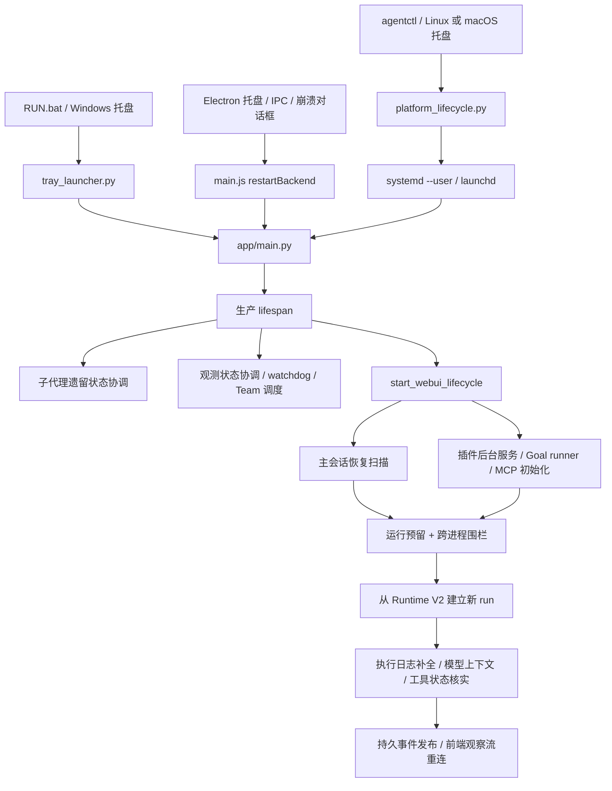

# Agent 重启链路梳理与完善方案

日期：2026-10-24。基于当前工作区源码；Git HEAD 为 `6188b69`，工作区已有大量未提交改动，本文审查包含这些改动后的实际文件，不代表该提交或已安装发行包的行为。

本轮完成代码追踪、隔离复现及针对性回归，不修改业务代码，不重启实际运行中的 Agent。

## 1. 核心判断

当前系统已经具备进程管理、持久运行记录、跨进程写入围栏、后台续跑及前端增量恢复。主要欠缺的是把这些机制连接起来的统一生命周期协议。

现状是：不同入口分别停止和启动进程；Python 启动时，各个恢复器再根据遗留状态决定如何继续。启动器没有获得完整的停机结果，恢复器也不知道这次是用户重启、崩溃恢复、升级，还是其他实例正在接管。

建议把目标定义为：**确认目标实例身份 → 停止接收新执行 → 有界保存和停止 → 确认旧进程退出 → 验证新实例就绪 → 按策略恢复 → 给出可核对的结果。**

第一阶段优先修进程身份和停止正确性；随后建立停机协议与恢复调度。现有 Runtime V2、审批恢复及 SSE 恢复应复用。

## 2. 先区分四种“重启”

| 名称 | 实际边界 | 主要入口 | 恢复方式 |
|---|---|---|---|
| 后端进程重启 | Python 进程整体替换 | Windows 托盘、Electron、`agentctl`、系统服务 | 磁盘事实和元数据重新装载；旧内存任务失效 |
| 会话中断后续跑 | 同一会话创建新的 run | `/sessions/recover`、`astream_events_continuation` | 重建模型上下文，闭合未完成工具调用 |
| 追问 interrupt/restart | 停止旧 run，应用新输入，再启动替代 run | `/sessions/{id}/steer` 相关逻辑 | 保持输入幂等、run 围栏、终态和前端顺序 |
| 扩展刷新或 worker 重启 | 插件/MCP 等局部资源替换 | 配置保存、插件刷新、worker 超时处理 | 各扩展重新发现或初始化；不等于 Python 后端重启 |

这些路径可以共享执行与恢复基础设施，但需要不同的原因、预算和结果。不要仅凭名称里出现 `restart` 就合并它们的状态。

## 3. 当前进程链路



### 3.1 Windows 源码版

入口：[RUN.bat](../RUN.bat)、[tray_launcher.py](../app/tray_launcher.py)。

1. `RUN.bat` 选择 Python，检查依赖，必要时安装，并按需构建 egress helper。
2. `run_starter()` 检查端口。端口已监听时，向已找到的托盘窗口发送 `WM_RESTART_AGENT`；没有找到托盘时，调用 `_stop_listener_on_port()`。
3. `_on_external_restart()` 或菜单 `_request_restart()` 通过进程内生命周期锁，进入 `_restart_agent_worker()`。
4. worker 调用 `_stop_agent()`，然后 `_start_agent()`，再 `_watch_startup()`。
5. `_start_agent()` 直接运行 `app/main.py`，传入托盘/监督进程 PID、端口，关闭后端自行打开浏览器。日志写入 `agent_terminal.log`。
6. `_watch_startup()` 以 TCP 监听判断成功，最长 120 秒；另一个线程负责打开或激活 WebUI。
7. `_watch_agent_process()` 处理意外退出：60 秒窗口最多自动拉起 3 次，退避从 0.25 秒增加到上限 2 秒。

需要明确的现有行为：**重复运行 `RUN.bat` 会请求替换已运行后端**，并非仅打开界面。菜单默认隐藏重启/更新，但这个替换启动路径仍存在。向托盘投递消息成功后 starter 立即返回，没有等待重启结果。

托盘单实例互斥名为固定的 `MyAgentTrayLauncher`，不是按仓库、工作区或端口区分。这个全局范围需要与未来多实例策略一起明确。

### 3.2 Electron 桌面版

入口：[packaging/electron/main.js](../packaging/electron/main.js)。

1. 托盘、IPC、运行中崩溃对话框共用 `restartBackend()`。
2. `backendRestarting` 防重复进入，重启期间更新托盘和进度条。
3. `stopBackend()` 在 Windows 调用 `taskkill /PID <child.pid> /T /F`；非 Windows 分支向负 PID 发送 `SIGTERM`。
4. 重启清空 layout 缓存，等待 800 ms 后重新 `startBackend()`，沿用已选择端口。
5. `waitForBackend()` 最长等待 180 秒，探测 `/api/runtime-status`；随后 `loadApp()` 加载页面。
6. 加载后再次验证 child 引用仍为当前后端，最后解除重启互斥并处理排队的激活请求。

已经修复且应保留的机制：按 child 对象登记预期退出；旧进程回调不能清空新后端引用；日志流绑定各自 child，并在 `close` 时关闭；退出取消重启定时器。相关历史说明见 [桌面重启修复记录](desktop-backend-restart-fix-2026-10-13.md)。

运行中的意外退出通过对话框让用户选择恢复，和 Windows 源码托盘的自动恢复策略不同。非 Windows Electron 分支使用负 PID，但 spawn 没有建立独立进程组；若要正式支持该路径，需要单独验证并修正进程组管理。

### 3.3 Linux/macOS

入口：[agentctl.py](../app/agentctl.py)、[platform_lifecycle.py](../app/platform_lifecycle.py)、[platform_install.py](../app/platform_install.py)。

| 平台 | 重启实现 | 系统恢复策略 | 当前就绪判断 |
|---|---|---|---|
| Linux | `systemctl --user restart sugaragent.service` | `Restart=on-failure`、`RestartSec=2`、`TimeoutStopSec=15`、`KillMode=mixed` | CLI 等 TCP 监听；托盘后台线程执行服务命令 |
| macOS | `launchctl bootout` 后 `bootstrap/kickstart -k` | `KeepAlive.SuccessfulExit=false`、`ThrottleInterval=2` | CLI 等 TCP 监听；托盘没有统一应用就绪回执 |
| Windows 共享控制器 | start 转调 `RUN.bat` | 由 Win32 托盘管理 | TCP；`stop()` 明确抛错，因此继承的 `restart()` 不能作为统一 Windows 重启接口 |

操作系统的服务管理应继续由对应服务管理器负责；应用层需要统一的是身份、停机、就绪、恢复和结果协议。

### 3.4 更新后的重启

[agent_updater.py](../app/agent_updater.py) 等待旧 launcher 退出，Unix 路径另行 stop 服务，执行 `git pull --ff-only`，仅在 requirements 内容变化时执行 pip。无论更新成功或失败，`finally` 都尝试重新启动。

这是“失败后尝试恢复启动”，并不是更新事务回滚。若 git 已更新成功、pip 随后失败，重新启动的仍是新代码与可能部分变化的依赖。更新入口也不完整复用 `RUN.bat` 的依赖检查/helper 构建流程。

需要分别定义源码更新、仅后端重启和 Electron 发行包升级；重启 Python 不会加载修改后的 Electron 主进程代码。

## 4. 后端启动、恢复和关闭

### 4.1 生产启动顺序

[main.py](../app/main.py) 的生产 lifespan 大致执行：

1. 配置模型客户端，启动 CPU 监测与 event-loop lag 探针。
2. **等待** `reconcile_orphaned_subagent_runs()` 扫描子代理任务索引。
3. 配置观测状态，后台协调孤儿 run，启动 watchdog 和自动迁移。
4. 启动 Team scheduler。
5. `start_webui_lifecycle()` 启动草稿 reserve、scratch 清理、缓存预热、checkpoint worker 和主会话恢复扫描。
6. 启动插件后台服务及受信任 host 生命周期；Goal runner 经此启动；安排 MCP、hook、prompt 和连接预热。
7. lifespan yield 后服务启动完成；后台恢复不要求全部完成才开放 HTTP。

`webui.py` 自身还有备用 `_webui_lifespan()`，仅调用 WebUI 的 start/stop。直接以 ASGI 方式加载它，与运行 `main.py` 的 watchdog、Team 和启动协调行为不同。未来应汇合到同一个生命周期组合器。

### 4.2 主会话续跑

关键实现：[webui.py](../app/webui.py) 的 `_is_recoverable_react_session()`、`_run_react_recovery_background()`、`_runtime_v2_auto_resume_pending()`；[run_ownership.py](../app/run_ownership.py)；[agent_loop.py](../app/agent_loop.py) 的 `astream_events_continuation()`。

恢复候选必须同时满足：没有本地 worker/占用；不由专属 workflow 接管；跨进程 owner 可判定为遗留；没有待处理人工交互；不是用户手动停止；最新 run 的持久状态允许恢复；模型历史可继续。

已实现的重要保障：

- owner 包含 PID 与进程创建时间，防 PID 复用；`live/unknown` 不自动接管。确认 owner 死亡后，不必再等待旧心跳的 30 秒宽限。
- 孤儿状态写入在会话事务锁内再次核对 owner，避免检查与接管之间的竞态。
- HTTP 继续与后台恢复共用 start reservation；模型写入另有 token 围栏，拒绝旧 run 的迟到写入。
- 恢复器在服务端消费 continuation，浏览器只观察；没有浏览器在线也能恢复。
- 使用新 run ID，从持久模型历史和执行日志重建上下文，不恢复旧 Python 调用栈。
- 手动停止原因有持久标记，不能被迟到的通用 `cancelled` 事件覆盖后再次自动续跑。

启动扫描先执行一遍，兼容没有明确 owner 的旧记录，再在心跳宽限结束后执行第二遍。`_REACT_RECOVERY_RETRY_SECONDS` 是调度冷却，不是定时重试器。失败会话在两遍扫描之后没有普通 ReAct 专用的持续重试循环；前端可对当前会话请求再次恢复，Goal 有自己的调度循环。

### 4.3 各类资源能恢复到什么程度

| 对象 | 当前重启后的行为 | 应保留的边界 |
|---|---|---|
| 普通主会话 | 从持久记录创建 continuation | 用户停止、人工交互、归档筛选和 owner 检查不能被绕过 |
| 推理/回答片段、工具参数和结果 | ExecutionJournal 恢复；补齐缺失 tool result、进度上下文和输出续写计数 | 参数草稿不是可执行调用；未写入的内容无法恢复 |
| 工具外部副作用 | 按 executed/process_state 判断；未知状态的相同操作有重复执行阻止机制 | 无法把“进程消失”视作“操作没发生”；跨系统副作用不能普遍保证 exactly-once |
| 待审批/待回答 | 持久交互卡片可恢复；审批校验摘要和原执行锚点；决策写入恢复上下文后正常续跑 | 只允许证明未启动的孤儿审批；不直接重放原工具。已启动/未知操作不能用该路径 |
| 子代理 | 旧进程的内存 task 不透明复活；遗留任务标记 `orphaned` | 父任务需明确收集状态、决定 resume/重新派发，不能假装原执行仍存活 |
| Goal | 插件 runner 重建，协调未完成 continuation，按预算/状态继续 | Goal 与普通 ReAct 恢复互斥；暂停和人工交互仍有效 |
| Team | 重新启动持久任务扫描、认领和唤醒循环 | 持久任务存在不等于旧 member worker 已恢复；需明确在途认领与子代理的协调策略 |
| 后台 job/PTY | 按 owner 懒恢复；旧 active job 标为失败，终端关闭，保存有界输出/游标，并尝试清理旧进程 | 不自动重放 Shell；持久终端不代表跨后端进程保留 shell |
| 插件/MCP | 重新初始化或连接 | 进程内等待者和临时租约不能自动被宣称为已恢复 |
| 前端 | snapshot + Runtime cursor 重放；新旧 run 有独立排序代际，卡片/执行记录按稳定 ID 合并 | 连接恢复只恢复观察，不应启动竞争执行；不能以 SSE 连接数代替运行状态 |

参考：[execution_recovery.md](execution_recovery.md)、[execution_services.md](execution_services.md)。

### 4.4 当前停机不足以承担“有序重启”

生产 lifespan 的 finally 会停止 CPU/watchdog、Team scheduler 和 WebUI 服务。`stop_webui_lifecycle()` 停止 host/plugin、草稿 reserve、普通恢复 worker、执行服务和请求 executor。

但当前没有一个共享的 draining 状态、所有生产者停止屏障、完整活动 run/人工恢复任务注册表与显式持久化屏障。关闭逻辑也缺少逐项隔离失败的整体结果：例如 host stop 抛异常会跳过同一 try 中的 plugin runtime stop。

此外，`uvicorn.run()` 没有配置 graceful shutdown 超时。本地安装的 uvicorn 会先等待连接/请求结束，再调用 lifespan shutdown；仅在 lifespan finally 中安排停止，不能保证长 SSE/请求期间及时执行。Windows 托盘仅给 2 秒优雅退出窗口，而执行服务自身的清理就可能包含 8 秒任务等待和 10 秒线程 join。Electron Windows 路径直接强杀，更不会执行这些清理。

指标和观测状态虽有 `atexit.flush`，硬终止不保证执行；可重建快照与不能丢的执行事实应有不同的停机持久化要求。

## 5. 已确认的问题与优先级

下面“隔离复现”指抽取当前真实函数体执行，替换系统命令/进程/存储依赖为桩，未操作真实 Agent。它证明对应分支行为，不代表已安装实例现场故障。

| 编号 | 优先级 | 问题和触发条件 | 证据 | 建议 |
|---|---|---|---|---|
| R1 | P1 | Windows 无托盘或停止兜底时，仅凭端口强杀，可能结束无关服务或其他实例 | `tray_launcher.py:480`、`:1157`；隔离 netstat 输入 PID 424242，直接生成 `taskkill /T /F`，没有 exe/cmdline/创建时间核验 | 只停止持有的 child，或有完整身份凭据的同一实例；未知端口占用明确失败 |
| R2 | P1 | 旧端口一直没释放，仍启动新进程，甚至把旧监听当重启成功 | `_stop_agent():1126` 仅记录日志；worker `:1067` 无条件 start。隔离复现中两次释放检查失败后仍调用 start | 返回结构化 stop 结果；未确认退出则终止重启，不进入 start |
| R3 | P1 | 正常重启缺少可靠停机协议，可能频繁退化成硬终止 | Electron `main.js:304` 直接 `/F`；托盘隐藏控制台 + CTRL_BREAK + 2 秒；临时进程信号探针未收到 SIGBREAK | 独立的本地控制通道执行 prepare/drain/checkpoint；确认后退出，超时才强制升级 |
| R4 | P1 | 新实例启动会把其他实例的活跃子代理标为孤儿 | `agent_subagent.py:912` 仅比较随机 instance ID 与本进程 registry；隔离复现中另一 instance 的 running child 被改为 orphaned，未核验其 PID/创建时间/围栏 | 与主 run 共用 owner 检查，并在跨进程会话锁内复核；无法确认则保留并报告 |
| R5 | P1 | 健康检查不能证明新后端身份和就绪，错误 HTTP 也可能成功 | 托盘/CLI/updater 只检查 TCP；Electron `main.js:379` 接受 200–499。真实 probe 函数隔离执行：302、401、404 均返回 ready | 独立 `/live`、`/ready`；仅认可明确 schema 与目标 instance ID，超时展示具体阶段 |
| R6 | P2 | 自动拉起遇到创建进程异常后丢失后续重试 | watchdog `:795` 先清空 proc；Popen 异常后下一轮遇到 proc None 直接 continue。隔离 6 次循环只发生一次 spawn 尝试 | 状态机独立记录待恢复状态；失败退避与重试次数不依赖 child 是否存在；明确熔断及手动重置 |
| R7 | P2 | 大量历史任务在冷启动时同时续跑，与前端加载争用资源；普通恢复失败后续重试不完整 | `webui.py:1085/1110` 按候选直接 create_task，无全局运行并发门；Goal 也独立 create_task；普通 ReAct 只有两遍启动扫描 | 统一恢复准入队列、并发和资源预算；有界重试及待处理结果；给可见会话与控制请求保留容量 |
| R8 | P2 | 没有贯穿入口、停机、启动、恢复的操作记录；关闭任务集合和失败隔离不完整 | 各进程各自日志/标志；stop 路径未统一涵盖所有 producer、人工恢复任务和预热任务 | `restart_id` 与生命周期任务注册表；阶段耗时/失败/强停原因；关闭尽力执行每项清理并汇总 |
| R9 | P2 | 更新失败后的“恢复启动”缺乏可验证的旧版本回退 | `agent_updater.py:121–132/246–267`；git 与 pip 就地更新后仍启动当前目录 | 先准备/验证候选版本，再切换；保留可运行旧版本和依赖环境；结果区分更新失败、回退成功、服务启动失败 |

R4 的跨实例问题不意味着单实例正常重启不能标记孤儿；问题在于“不是本进程的 instance”不能证明“原 owner 已死”。

R3 中信号路径的现场可用性取决于控制台与启动方式；本轮临时探针说明不能依赖发送调用成功作为已处理信号的证据。应以应用 ACK、退出和状态落盘为判断依据。

## 6. 推荐的统一协议

### 6.1 职责和状态

监督器负责持有进程身份、重试退避、启动/退出观察；Python runtime 负责停止执行入口、终止或保存任务、提交恢复事实。HTTP/桌面/CLI 只提交操作并展示结果。

```text
requested → preparing → draining → stopping → stopped
          → starting → serving → recovering → completed

任一阶段可进入 failed；强制停止必须记录 forced=true 与原因。
```

`serving` 表示基础 HTTP/控制请求可用；`recovering` 表示符合策略的旧任务仍在排队或协调。重启操作完成应表示“目标新实例通过就绪验证，恢复清单已协调/提交调度”，不应等所有旧任务执行完才完成，也不应把旧任务最终完成与重启成功混在一起。

建议最小身份和回执字段：

```text
restart_id, reason, requested_by, requested_at
instance_id, supervisor_id, pid, process_created_at, runtime_root, data_root, port
old_instance_id, expected_new_instance_id, phase, phase_started_at, deadline
drain_policy, resume_policy, forced, error_code, error_detail
recovery: queued / running / waiting_human / skipped / unknown / failed
```

- `restart_id` 用于幂等，phase/generation 用于拒绝旧回执。
- `instance_id` 每次启动都更新，不能只比较 PID 或端口。端口由监督器选择，身份由受控启动参数和新后端握手共同验证。
- 同一个实例只能由一个 owner 管理；Windows 固定 mutex、系统服务 label 与 Electron 单实例范围应明确对应关系。
- 停机控制通道只授权当前监督器；优先本地 IPC/命名管道，或受控一次性令牌。不要提供可被普通页面任意调用的无保护关机接口。

### 6.2 停机顺序

1. 先写入 restart intent，设置 draining；新 `/chat`、恢复、Goal、Team、job 唤醒和插件派发不能再启动执行。读取和必要交互决策仍可保留。
2. 冻结调度生产者，快照活动 run、工具、子代理、job、终端及待人工交互，给每项明确分类。
3. 对可取消执行发出取消并等待有界清理；对不可中断执行等待安全点，超过预算标记 unknown。`restart` 中断原因必须与用户手动停止区分。
4. 保存已收到输出、运行终态/中断原因、队列、审批锚点和必要执行事实；对无法确认的操作保留核实要求。
5. 关闭观察流并发送重启提示，停止插件/MCP/执行资源等；单项失败不跳过剩余清理。
6. 向监督器返回准备完成及未结事项，再触发 ASGI 退出；监督器等待该 child 真实退出并释放监听。
7. 超时才升级强停，只针对确认身份的进程树；保留强停原因和新进程的恢复提示。

应用内 drain、uvicorn graceful timeout、外层 supervisor/service stop timeout 应构成递增预算。具体秒数应根据实际长工具清理测量确定，不把现有 2 秒窗口当作足够的默认值。

### 6.3 恢复顺序和策略

1. 先检查存储可读性和实例所有权，收敛旧记录状态；unknown 不猜测为已死亡。
2. 挂载待人工交互，保留用户停止和暂停；已完成/归档候选按各 workflow 既有策略处理。
3. 建立恢复清单，先恢复观察能力和当前可见会话，再由有界队列执行其他恢复；前端、用户输入与控制请求应有保留容量。
4. 普通会话、Goal、Team、人工决策后续跑和 job 唤醒共享执行准入与 start reservation；domain scheduler 只提交意图，不各自无限制启动。
5. 复用 ExecutionJournal 补全协议。已完成工具不重复；未执行草稿不重放；未知副作用先核实。对外操作可逐步增加能力级幂等键/结果凭据。
6. 对可重试错误有界退避；不兼容数据、未知 owner、无法核实的副作用进入明确待处理状态。重启不能重置输出续写、Goal、成本与操作重试预算。
7. 生成恢复汇总，用户能看见哪些已继续、哪些等回答、哪些失败、哪些需核实，而非只看到“服务已启动”。

用户主动重启可提供“等待安全点”与“立即中断并按策略恢复”等选项；崩溃路径使用保存的恢复策略。首次落地不必增加复杂 UI，但策略字段需要从一开始明确。

## 7. 分阶段落地与验收

| 阶段 | 建议范围 | 完成条件 |
|---|---|---|
| A：进程操作正确 | R1/R2/R4/R5/R6；托盘、Electron、共享平台控制器 | 不杀未知进程；未停不启；只接受目标新实例；spawn 失败按预算重试；不改写活跃其他 owner |
| B：有序停机 | 新生命周期组合器；统一 main/备用 ASGI；drain + 持久化 + 退出 ACK | SSE/长请求不无限阻塞；手动停止与重启语义独立；清理失败仍执行其他清理；外层预算可覆盖应用清理 |
| C：恢复调度 | 主恢复、Goal/Team、人工交互与执行唤醒的统一准入 | 恢复不会挤占全部控制/UI容量；一个会话只有一个 writer；有界重试；可查询恢复清单 |
| D：用户结果与观测 | 结构化 restart 记录，统一失败原因和入口回执 | starter/CLI/Electron 能追踪同一个操作；可区分停机失败、启动失败、恢复待处理与重启成功 |
| E：可靠升级 | 独立候选代码/依赖环境、验证、切换与回退 | pull/pip/首次启动任一阶段失败，都能回到经过验证的可运行版本；发行包与源码升级语义清楚 |

不建议第一步把所有启动器强行合成一个跨平台进程管理实现。先定义相同契约，再让 Win32、Electron、systemd、launchd 各自适配，改动边界更可控。

需要补充的验收矩阵：

| 场景 | 必须验证 |
|---|---|
| 停止失败/端口不释放 | 保留旧引用，不 spawn，不报告成功，不结束其他监听者 |
| 端口被其他 HTTP 服务占用 | TCP、302、401、404 均不能冒充目标就绪；实例 ID 不符拒绝 |
| 正常重启 + 活跃 SSE | drain 能开始，事实保存完成，旧实例退出，新实例通过身份握手 |
| 创建进程失败/启动即退出/卡住 | 有界退避、明确失败、可手动重新启动，不能因 proc=None 永久失去重试 |
| 迟到 exit/close/健康响应 | 不清空新 child，不覆盖新日志/状态，不提前解除新操作互斥 |
| 双击 RUN/托盘/IPC/更新并发 | 同实例操作幂等或明确冲突；不同数据根不串操作 |
| 两个实例共享数据 | 活跃 main/child owner 不被接管；owner 无法确认时可诊断 |
| 工具执行前/中/后各阶段强停 | 草稿不执行，完成不重复，unknown 先核实；保留已收到输出 |
| 待审批/待回答/用户停止 | 卡片恢复、摘要绑定、一次消费；停止的会话不自动继续 |
| 普通会话 + Goal + Team + job 同时恢复 | 同会话单 writer；跨会话并发受控；预算不重置；UI可用 |
| 更新 pull/pip/首启失败 | 可核验的服务恢复/回退结果，不只返回已调用启动 |
| 备用 ASGI、各系统托盘/CLI | 生命周期契约一致；通过临时数据根和随机端口做真实子进程验收 |

## 8. 本轮验证与限制

执行的针对性测试：

```powershell
.\python\python.exe -m pytest tests/test_tray_launcher.py tests/test_platform_lifecycle.py tests/test_agent_updater.py tests/test_run_ownership.py tests/test_react_recovery_runner.py tests/test_execution_recovery.py tests/test_queued_followup_recovery.py tests/test_execution_recovery_noop_writes.py tests/test_desktop_shell.py -k 'not startup_feedback_in_real_electron and not native_electron_notification and not toast_selects' -q
# 142 passed, 6 deselected

.\python\python.exe -m pytest tests/test_execution_restart_browser.py tests/test_platform_install.py -q
# 6 passed；前者 2 项使用真实无界面浏览器 DOM，无后端服务

node --test tests/js/execution_recovery_runtime.cjs tests/js/restart_recovery_order_runtime.cjs tests/js/execution_restart_order_runtime.cjs tests/js/stream_recovery_runtime.cjs tests/js/tool_pending_history_recovery_runtime.cjs tests/js/startup_failure_recovery_runtime.cjs
# 11 passed（Node test runner 计数，其中部分条目为文件级检查）
```

首组 pytest 通过桌面外壳入口还运行了其 Node 模拟测试，不把内含断言另加到 Python 用例数量。托盘和 owner 测试使用独立临时子进程；没有重启仓库正在运行的后端。

额外隔离复现：

- 提供虚构的端口占用 PID，真实端口清理函数生成强杀命令，命令由桩收集而未执行。
- 模拟两次端口释放超时，真实重启 worker 仍执行 start。
- 模拟 watchdog 自动启动抛出 OSError，后续循环不再尝试创建进程。
- 提供另一 instance 的 running child，真实协调函数不检查 owner 活性便写入 orphaned。
- 真实 Electron probe 函数在虚拟 HTTP 依赖下接受 302、401、404 为 ready。
- 临时 Python 进程注册 SIGBREAK handler，以与托盘后端相同的隐藏控制台/新进程组标志启动。发送 CTRL_BREAK 调用未报错，观察窗口内未收到信号且进程仍存活；随后仅清理该临时进程。

现有测试通过说明既有覆盖仍成立；上述隔离复现说明这套覆盖尚未保证完整重启协议。未在真实运行任务上进行强停，也未在 Linux/macOS 或已安装 Electron 发行包上做端到端重启验收。R7 的冷启动负载风险来自代码准入分析，未在本轮制造恢复风暴或给出性能改善数字。
