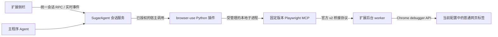

# SugarAgent 浏览器扩展重设计（2026-10-29）

本方案替代旧侧栏设计与自定义 CDP 动作引擎方案。对应实现为 `browser-extension/`、`plugins/browser-use/`；验证记录见 `browser-extension-implementation.md`。

## 产品形态

一个 Chrome／Edge 扩展，同时承担侧栏对话与现有浏览器连接。用户继续使用自己的浏览器配置和登录态；主程序和侧栏访问同一份会话。首版面向本机，支持所有普通网页标签，排除浏览器内部页面、扩展页面和隐私窗口。

侧栏参考本机 `SugarAgent Demo/dsh-better-display` 的阅读方式：单列正文、轻量过程行，运行时显示真实的思考与工具记录；收到任务成功终态后折叠过程，失败与审批保持可见。支持 Markdown、代码、公式、Mermaid、会话图片、窄宽、深浅色和中英文界面。

2026-10-30 用户确认采用 M「我的重设计」组合，0.3.0 已实现：路径式会话、小图居中、密集工作、继续最近会话、上沿项目入口、文字快捷入口、模型与思考、平直输入面板、小方发送按钮、用户气泡与平铺回答、单行折叠过程、图标与反馈浮层。具体选项保存在 `browser-extension/design-review/user-selection-2026-10-30.json`，400px 深色为本次选型基准；独立子 Agent 的 S 组合保留为设计资料。

## 侧栏 UI 基线

紧凑、简约是默认原则。侧栏优先给对话正文留空间，不套用主窗口的大标题栏、页面内边距和重复状态说明。

- Pending 每个任务一条单行（当前为 30px），长文本省略，完整内容可悬停查看或编辑；附件用小标记，操作入口保持独立。避免为队列再叠加独立大标题和第二行等待状态。
- 提问、审批、文件预览等标题只占一行；标题与状态使用与正文接近的字号。卡片和弹窗按自身用途定义最小必要间距。
- 不给通用 `header`／`section` 设置页面级 padding 或字号，让每个组件显式管理布局，避免内外层叠加出大片空白。
- 新增和调整组件均检查 320／400px 宽度、三种主题、长标题和实际打开的内容。检查功能时同时检查留白与占用高度。

## 工具决策

**首版不新增模型可见的浏览器操作工具。** 采用固定版本 Playwright MCP 提供的 20 个 core／vision 工具及原始 Schema。点击、输入、截图、标签操作、上传、等待和导航由 Playwright 执行。`browser_evaluate`、`browser_run_code` 等任意代码工具不在首版启用范围。

0.4.0 新增只读元数据工具 `browser_get_context`，返回浏览器活动页、本轮绑定页及选区。原有 20 个网页工具的 Schema 保持不变。侧栏发送时默认自动关联页面引用，正文由原有工具按需获取；引用随持久输入保存，每轮目标独立，用户切换标签不会中途改目标。主程序 Agent 可主动查询相同上下文。

新增部分是宿主连接设施：配对、认证、会话订阅、文件入库、浏览器选择、调用排队、标签写入占用和恢复。这些是应用内部接口，不构成第二套网页动作工具。

## 连接与任务所有权

- 任务由后端持有。侧栏关闭只断开显示端，任务和网页调用继续运行。
- 每个会话有独立的 Playwright MCP 客户端和当前标签；同一浏览器的操作串行调度，同一标签的写操作按运行占用，终态释放。
- 默认浏览器变化从下一次运行生效；当前运行保持既定浏览器，避免任务中途转到另一份登录态。
- 调度后、真正调用前再次复核权限模式。取消会阻止尚未发送的动作；已发送动作若结果不明，要求先观察页面再决定后续操作。

## 会话与资料

统一会话服务负责创建、历史、模型选择、排队消息、停止和审批。历史读取 Runtime V2 UI 投影，先完成实时订阅确认，再补拉历史并去重。较早历史分页不会清掉正在输出的正文。

网页正文和选区由用户手动附加，保留 URL、标题与采集时间，并明确标记为外部资料。切换标签不自动采集。上传文件走主程序现有入库逻辑，侧栏只提交宿主签发的附件 ID；图片按设备授权或实际会话引用读取。未发送的网页资料、附件和草稿可以在重开侧栏后恢复。

## 配对与恢复

主程序生成十分钟、一次性的浏览器专用配对码；扩展获得限定能力的设备凭据。无需打开旧远控开关或修改全局 CORS。服务只接受 loopback 连接；扩展来源、设备状态与插件授权都参与校验。原生桥接还需要随机令牌。

心跳与持久 alarm 恢复后台连接。worker 被回收后，先清理本扩展记录的遗留 debugger 连接，再建立新协议代次。重连不会自动重放点击或提交；页面与登录态保留。用户可以暂停控制、停止任务或在主程序撤销配对。

## 交付边界

主／子会话导航沿用主 UI 的胶囊入口，放在现有 42px 标题栏，不额外占据一排。菜单条目约 30px，名称省略，状态短标签；选中的子会话旁提供返回父会话按钮。正文、执行过程、提问、用量、草稿和资料按实际所选会话隔离，子 Agent 的转发事件只更新目录提示。

交付扩展加载目录、ZIP、锁文件、上游版权说明、browser-use 后端插件及安装文档。真实浏览器验收使用独立临时配置和本地测试网页；共享会话与权限使用隔离的真实后端测试。日常浏览器配置与正在运行的后端不由安装脚本自动修改或重启。
