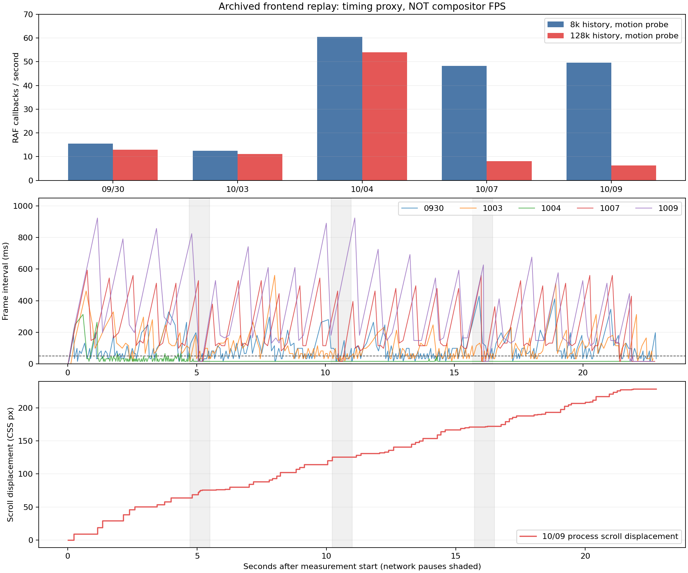

# 五个备份版本的流式自动上滚对照（2026-10-10）

已在本机隔离副本中复现明显停帧。五个版本都可能停帧，9 月 30 日不是稳定流畅的基线。长历史显著放大 10 月 7 日与 9 日的停顿，版本之间的表现有波动，不能把这次结果解释为某天首次引入或稳定排名。

## 测试方法与边界

使用五份 zip 各自的原始 Vite JS、CSS 与改动审查插件，不重建、不混用当前源码，不启动生产后端。只抽取前端所需文件到临时目录。注入诊断入口连接原版历史渲染、SSE 消费与滚动跟随函数；隔离服务提供固定数据。真实会话、原始 zip、当前 frontend 和 dist 均未修改。

Edge 前台，1280×800、deviceScaleFactor=1、16px 字号、浅色主题、丝滑输出开启，不关闭 GPU。8k/128k 是 cl100k_base 对测试历史正文的计数，分别 22,137/354,215 字符、23/355 条过程记录。它不是目标模型的真实输入 token 数，也没有真实调用 LLM、工具或后台执行，因此不能代替真实 100k 模型任务全链路测试。

每轮相同 240 个 SSE 增量，每 80ms 发送 4 字符，合计 960 字符；在第 60/120/180 个增量前增加 700ms 停顿，输出后继续采样 1.5s。使用原版流水线正常处理 execution_id：9/30、10/03 走旧增量展示；10/04 起走其执行记录路径。

RAF 回调间隔、Long Task 与 Long Animation Frame 为浏览器主线程指标，**不是最终屏幕/合成器的实际 FPS**。位移探针逐帧读取 scrollTop 和固定文字位置，会增加测量成本；另外运行仅记录回调间隔的轻量对照。CUA/开发者连接、本机其他负载与单一浏览器环境也可能影响绝对数值。

## 同一位移探针的代表样本

下表选取每版最新有效位移样本，用于对照同一测试负载，不作为发布版本性能排名。

| 备份 | 8k 历史：回调/秒 | 128k 历史：回调/秒 | 128k：P95 帧间隔 | 128k：最长帧间隔 |
|---|---:|---:|---:|---:|
| 20260930 | 15.6 | 12.9 | 214ms | 429ms |
| 20261003 | 12.5 | 11.1 | 231ms | 560ms |
| 20261004 | 60.5 | 53.9 | 33ms | 313ms |
| 20261007 | 48.2 | 8.0 | 527ms | 593ms |
| 20261009 | 49.6 | 6.2 | 725ms | 923ms |

## 已确认与尚未确认

- 已复现停帧和停住后继续向上移动。轻量探针也复现：长历史正常加载插件时，9/30 约 15.2 回调/秒，10/04 两轮约 33.9 与 52.5，10/07 约 8.1，10/09 约 9.7。10/03 的早期轻量样本缺少空页面校准，不作为有效排名依据。
- 长历史不是统一门槛：9/30、10/03 的 8k 回放也停帧；10/04、10/09 的部分短历史样本接近 60 回调/秒。10/09 的 128k 数字标记、仅 8k 正文对照约 51.9 回调/秒，支持实际页面负载比数字标记更值得排查，但该对照只有一轮。
- 10/09 长历史位移样本中，约 0.5–1 CSS px 的小步移动和明显停顿均存在；没有记录到执行框或主对话 scrollTop 反复倒退，固定文字位置也没有记录到向下反跳。因此尚未证实用户看到的约 1px 反复上下抖动，更不能排除合成/像素栅格导致的视觉抖动。
- 完全不加载改动审查插件，10/09 的长历史轻量样本仍约 8–9 回调/秒。因此插件不是本次回放卡顿的必要条件。这个对照没有证明插件在其他真实任务中完全无影响。
- 10/07 原版滚动跟随计时约 0.15ms/次，而两次回调间隔平均约 125ms。10/09 额外诊断中，240 次 renderExecutionEvent 合计约 131ms，renderExecutionRecord 约 119ms，观察器回调几十 ms；同时长任务累计约 20 秒。嵌套计时不可相加、也不能与长任务做直接差分归因。
- 10/09 无插件诊断的一轮原生 Performance 计数（包含准备历史与测量窗口）为：RecalcStyleDuration 9.31s、LayoutDuration 0.48s、ScriptDuration 0.76s、TaskOtherDuration 14.74s、TaskDuration 25.51s。样式重算是具体排查方向；其他任务归属仍未知，不能把这些数值全部算成输出阶段成本。
- 10/07 与 10/09 嵌入的滚动、丝滑输出、执行渲染、SSE 消费代码哈希相同；9/30 与 10/03 的丝滑输出核心哈希相同。完整 JS/CSS/插件并非全部相同。

## 数据有效性

排除浏览器后台/遮挡导致约 1Hz 节流的首轮样本。另排除同页面重复回放时命中 SSE 去重、输入到达但没有实际渲染的一轮；回放入口已补充清空测试会话的 SSE 游标和执行记录，并校验实际生成文字长度。有效对照均为新页面运行；早期样本通过位移记录中的实际文字增长或 240 次渲染调用复核。10/04 曾采到历史执行框而非新执行框：该旧记录只保留帧间隔，不用于位移结论；后续已跟随当前 ctx 的执行框重测。

## 下一步

优先拿真实卡顿任务的浏览器 Performance 调用栈与样式失效记录，定位样式重算与 TaskOtherDuration：关注历史 DOM 规模、全局选择器/状态属性失效、浏览器绘制及辅助功能处理。当前接口不支持 CPU Profiler（-32601），尚未拿到调用栈。随后在同一回放里只隔离被证据定位的规则或路径，重复对照；目前没有实施修复。

## 复现与原始记录

运行 `python/python.exe scripts/performance/prepare_archived_stream.py`、`node scripts/performance/inspect_archived_bundle.cjs`、`python/python.exe scripts/performance/serve_archived_stream.py`。打开其输出地址，只测前台页面；用页面按钮选择历史规模与探针，记录自动保存在临时目录。`?plugins=off` 是仅测试页面的不加载插件对照；`&observers=time` 额外记录同步渲染函数和观察器耗时。最后运行 `python/python.exe scripts/performance/report_archived_stream.py`。临时诊断入口不进入产品构建。

[摘要与版本哈希](archived-stream-2026-10-10-summary.json) · [全部原始记录（含排除样本）](archived-stream-2026-10-10-raw.zip)
