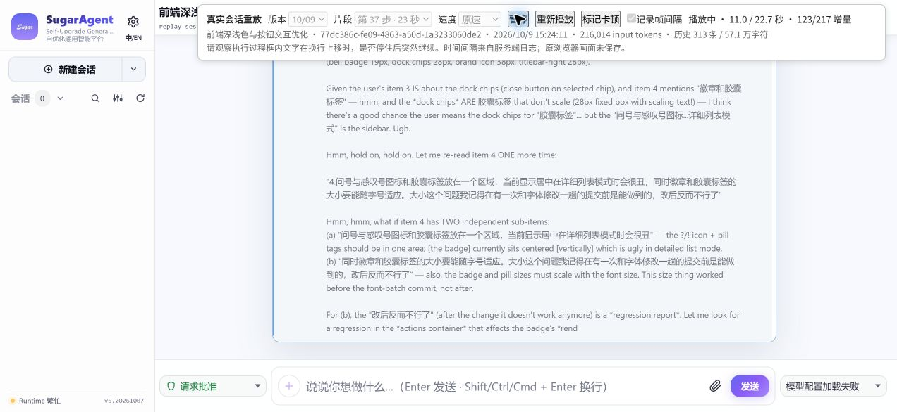

# 真实会话重放：用于确认卡顿表现

用户已确认：重放中的卡顿效果与实际遇到的一致；同一版本每次播放仍可能有卡有顺。动画回调间隔依然不能称为屏幕实际帧率。

当前入口：[打开 10/09 版本重放](http://127.0.0.1:54871/?real=1)。页面支持切换 09/30、10/03、10/04、10/07、10/09 五份备份，播放、暂停、重播、改变速度，以及标记肉眼看到卡顿的时刻。该地址由本机临时隔离服务提供，服务关闭后需要重新启动并使用新打印的地址。



## 原始材料

使用此前用户明确指出正在卡顿的会话：`77dc386c-fe09-4863-a50d-1a3233060de2`，名称“前端深浅色与按钮交互优化”。只读其已有 `events.jsonl`、UI 行快照和 blob；不会重建原会话投影，不会调用模型或执行历史工具。

| 片段 | 原始北京时间 | 模型 input tokens | 真实增量数 | 完整文字字符数 | 总重放时长 |
|---|---|---:|---:|---:|---:|
| 第 37 步 | 10/09 15:24:11.608 开始 | 216,014 | 217 | 8,522 | 22.687 秒 |
| 第 41 步 | 10/09 15:25:26.704 开始 | 228,423 | 607 | 28,592 | 64.204 秒 |

第 37 步的文字增量持续约 19.6 秒，之后还保留原始完成记录的时间间隔；第 41 步同理。历史快照严格过滤到各片段第一条增量之前，第 37 步有 313 条 UI 事件、约 57.1 万字符，第 41 步有 324 条、约 59.5 万字符。这里的字符数包含历史工具结果，不等同模型 token 数。

增量逐个来自持久化执行日志，拼接文字已与原始完成记录逐字校验。原速按日志时间戳发送，不额外插入测试停顿。时间戳是服务端写入时间，不是当时浏览器接收或显示时间；原画面的像素、帧序列、网络调度和系统负载没有被保存，因此这是一份真实内容与服务端节奏的重放，不能称为原画面录像。

## 渲染与校验

前端使用各 zip 内原始 JS/CSS 以及改动审查插件，未重新构建。诊断入口调用该版的历史渲染、SSE 消费与自动跟随函数。10/04 起走其原生执行更新路径；09/30 和 10/03 把同一原始文字适配到旧版增量 API。旧版额外记录已接受事件游标，供暂停续播使用。

重放页的“记录帧间隔”仅记录 RAF 回调时刻，不逐帧读取布局或文字坐标。可关闭后用肉眼对照，避免默认假定测量与观察是同一种问题。“标记卡顿”记录原始时间偏移和日志 seq，便于用户指出具体片段。切换版本会打开另一份隔离副本，并加载相同会话片段。

首次 10/09 重放已确认 217 个增量与 8,522 字符全部显示，文字校验通过，页面未报告错误，动画回调最大间隔约 280.3ms。09/30 兼容路径也通过完整文字校验。用户随后确认视觉症状一致，同时反馈重复播放有概率性。暂停、改变速度、切到后台的记录需要单独解释，不能与不中断的原速前台样本直接对比。

[首次原速重放的记录](real-session-2026-10-10-first-result.json)。另已验证 09/30 第 37 步在 125/217 增量处暂停、从原游标继续后完整文字仍校验通过，无重复字符。

输出记录保存在准备脚本打印的临时目录，文件名 `real-版本-时间戳.json`。产品 frontend、dist、备份 zip 和原会话均未因本次重放修改。

## 同版本重复播放与历史渲染对照

10/10 追加诊断只使用 10/09 备份、第 37 步、原速。原始增量和时间戳相同，不加入人为停顿。诊断页增加服务发送计时、页面消费计时、执行记录渲染函数计时、长任务/长动画帧记录；浏览器原生 Performance 计数器通过本机浏览器接口读取。

原逻辑重复播放的最长 RAF 间隔出现 181.3、280.5、906.6、675.9 毫秒等不同结果。各轮完整文字校验通过，未暂停、未切入后台、无页面错误。普通重放页保存的两轮 10/09 样本也出现 52.8 与 47.8 次/秒的平均 RAF 回调频率。普通页与诊断页的视口尺寸及采集负担不同，不能将两类样本混在一起排名。

进一步只在诊断页临时设置旧历史条目 `display:none`：隐藏当前片段开始前已有的 74 个顶层历史元素/执行条目，保留当前执行框、同一段新输出、原自动跟随逻辑和完整内存记录。历史并未删除，模型 input tokens 标签仍为 216,014。这个实验改变了历史内容参与渲染和滚动的条件，不能当成保留全部历史体验的正式修复。

同一页交替测试，视口 1272×586、DPR 2，结果如下。浏览器原生计数器的区间严格从播放前到播放完成，约 22.9–23.0 秒，不包含历史准备阶段。

| 顺序 | 历史呈现 | 平均 RAF 回调次数/秒 | RAF 间隔 P95 | 最长 RAF 间隔 | 原生样式计算累计 | 长任务数 |
|---|---|---:|---:|---:|---:|---:|
| 7 | 完整历史 | 17.5 | 214.2ms | 296.7ms | 13.20s | 149 |
| 8 | 临时隐藏旧条目 | 53.3 | 33.0ms | 98.9ms | 4.59s | 24 |
| 9 | 恢复完整历史 | 23.2 | 115.2ms | 148.5ms | 12.45s | 182 |
| 10 | 再次隐藏旧条目 | 55.8 | 32.9ms | 65.8ms | 4.26s | 6 |

四轮均接收 218 条记录（217 个文字增量及 1 条完成记录），8,522 字符逐字校验通过。对应服务发送相对计划的最大误差分别约 3.39、1.68、4.55、1.52ms。完整历史两轮的脚本累计约 0.47/0.46s，布局约 0.67/0.62s；直接执行记录渲染函数合计约 367/301ms。页面消费时间相对服务发送时间会进一步延后，这个计时包含浏览器主线程调度，不能冒充网络包抵达时间。

目前可确认：相同代码和输入仍会产生不同程度的停顿；在这个真实片段、当前诊断环境中，旧历史参与渲染显著加重了样式计算和动画回调停顿，两次交替对照均复现改善。它支持继续查历史子树的样式更新、渲染与滚动范围，尚未定位具体选择器、触发函数或全部概率来源。也不能据此认定某个日期版本是引入点。

两个更窄的临时对照未消除停顿：关闭执行框 CSS 动画/过渡的一轮仍有 610ms 间隔；跳过相同 `data-smooth-follow-owned` 属性的重复写入仍有 148.5ms 间隔。单轮变化不能证明因果或修复。它们没有加入产品 frontend；诊断页最终关闭，临时 CSS/属性拦截随之清除。

[重复播放与对照的汇总数据](real-session-variability-2026-10-10.json) 保留各轮来源、环境、排除条件及原生计数器。前几轮原生计数器读取包含播放后等待，因此样式耗时对照只使用表中第 7–10 轮的严格区间。第 1 轮执行记录计时钩子未成功安装，其渲染次数为 0 的字段不参与函数耗时分析；后续已修正。

## 重启方法

在项目根目录依次执行：

```powershell
python scripts/performance/prepare_archived_stream.py
node scripts/performance/inspect_archived_bundle.cjs
python scripts/performance/prepare_real_session_replay.py
python -u scripts/performance/serve_archived_stream.py
```

已有临时备份材料时可省略前两步。使用服务打印的 20261009 地址并加 `?real=1`。播放期间保持页面前台；看不清时可选半速，但半速会改变输入节奏，仅用于观察动作。
