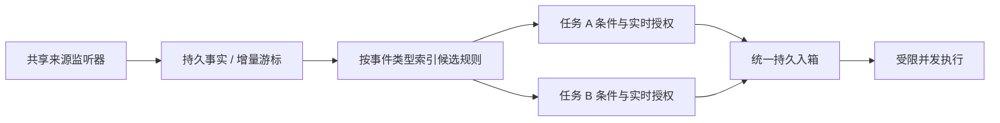

# 事件监控的资源复用

监控资源按来源共享，任务仅订阅事件并保存独立规则、权限和执行配置。相同资源上的多个任务不应各起一个监听线程或重复轮询。

## 当前实现

通用事件任务共用 SessionControlService 的后台 asyncio 循环及 AutomationService 的事件桥，不按规则新建线程。事件总线监听器只标记变化会话，重复扫描唤醒通过 dirty 集合合并；日志按持久游标增量读取，每次处理有限数量的会话与事实。Token 和心跳不触发业务自动化。

规则消费每批读取一次目录，按事件类型分组；只对相应候选规则计算条件。每次派发前仍读该规则的当前版本，暂停、删除或修改立即阻止旧版本派发；权限与来源撤销由公共控制服务继续检查。失败只暂停相应规则；旧版本派发失败不会覆盖并发保存的新版本。新建/修改后的规则在下一批索引中使用，不重放配置生效前的历史事件。

扫描唤醒可以合并，不同业务事实不能任意合并或丢弃。事件与游标继续持久化，批次提交失败重放时复用稳定派发 key。

本次没有新增线程、常驻进程或另一套事件数据库。Goal、后台任务、子 Agent 唤醒和 B站轮询仍有各自领域的异步循环；其执行意图已经接入统一入箱，来源采集尚未全部收口。

## 更多来源接入时的边界

可在同一后端中增加共享来源注册表。复用键包含来源类型、规范化资源、账号/凭据命名空间、工作区及影响采集语义的选项；不能仅以 URL、目录名或任务 ID 判定。示例：

| 来源 | 复用单位 |
| --- | --- |
| 会话 / 工具 / 子 Agent 完成 | 现有事件总线及持久事实桥 |
| 文件或目录变化 | 同一授权范围内、同一规范路径和监听选项 |
| 外部平台轮询 | 同一账号、接口、查询参数和凭据范围 |
| Webhook | 同一已配置来源；验签持久化一次再分发 |

注册表维护订阅引用数，首次订阅启动采集，最后一个订阅离开后释放资源。相同轮询请求只采集一次，再分发给不同规则；退避、频率与服务限额由来源统一控制。更换账号、撤销授权或停用插件时使旧订阅失效。

共享服务优先复用后端事件循环；阻塞 SDK、磁盘和网络调用进入有界工作池。强制把所有操作塞进一个操作系统线程会让慢来源阻塞其他来源。共享的是采集和扫描成本，匹配后的任务仍使用独立授权、运行配置、幂等键及会话单一写入保护。

## 验证

`tests/test_shared_event_monitor.py` 验证 500 条规则、100 条事件只全量加载一次规则目录，且只匹配 100 次相关候选；同时检查批次中的暂停、编辑、删除、故障隔离及并发配置保护。现有事件桥批量写入、游标原子提交及重放去重测试继续适用。此为结构性成本验证，不代表实际机器 CPU 或功耗下降的百分比。
