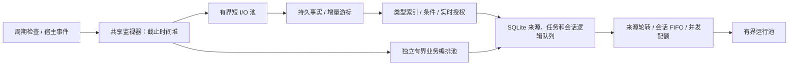

# 共享监视器、有界工作池与独立任务队列

三个部分现已接入后端。核心实现位于 `app/session_control/monitors.py`、`resources.py`、`store.py` 和 `service.py`。管理脚本的 doctor / RPC system.health 可查看来源数量、工作池上限及占用。



## 共享来源

来源按 MonitorKey(kind, resource, namespace, options) 共享。namespace 为插件或内部来源边界；options 的稳定摘要区分账号、凭据代次、递归模式、查询参数等采集语义。key 不包含密钥文本。相同 key 的订阅共用一次采集和结果，保留独立消费者和引用数；最后一个订阅离开时停止采集并清理资源。冲突的间隔或事件选项拒绝注册。

应用只有一个监控调度循环。事件按类型定位来源，唤醒合并，截止时间堆限制过期项；采集失败退避，消费者异常隔离。插件停用时撤销当前订阅、禁止后续采集，并取消尚未开始的业务工作。重新启用拥有新的订阅生命周期。

已迁移的领域来源：

| 来源 | 接入方式与保留状态 |
| --- | --- |
| 通用定时 / 内部事件 / 持久事实桥 | control 来源，统一调度 |
| Goal | Goal 来源；保留目标、Judge、预算和退避 |
| 后台任务结果 | job-results 来源；保留进程、PTY 和任务状态服务 |
| 子 Agent 完成唤醒 | subagent-results 来源；完成事件唤醒并周期核对，保留子任务注册表 |
| B站值班 / 入站消息 | duty / inbound 来源；保留账号、窗口、额度、游标和发送 outbox |

以上入口不再启动各自永久轮询循环。短回调只检查事实并持久投递，模型完成后的记账由运行生命周期回调处理。几个领域共用单飞的会话目录快照，默认缓存 5 秒，生命周期事件使其失效；缓存不用于授权。

SDK 连接、PTY、后台进程和子 Agent 内部执行仍属于各自服务，其必要传输线程不等于重复监控线程。此次没有新增文件系统监听产品功能；更多目录或外部接口可通过同一来源注册表接入。

可信宿主 API 示例：

```python
from session_control.public import host_monitors
from session_control.monitors import MonitorKey

hub = await host_monitors()
subscription = hub.subscribe(
    MonitorKey.make("poll", resource_id, namespace=plugin_id,
                    options={"account": account_id, "query": query}),
    owner_id, collect, consume=consume, interval=30,
    cleanup=release_resource,
)
subscription.wake()
await subscription.close()
```

collect 必须有界、可取消；阻塞 SDK 应配置自身超时，cleanup 需能安全处理采集取消。消费者应基于已持久化事实幂等投递。扫描唤醒可以合并，不同业务事实不能任意合并或丢弃。

## 显式预算

下表环境变量名称均添加 MYAGENT_ 前缀，参数为正整数；修改后重启后端。

| 资源 | 默认上限 | 环境变量后缀 |
| --- | --- | --- |
| 监听回调并发 | 总计 4，每命名空间 2 | MONITOR_CONCURRENCY / MONITOR_PER_SOURCE |
| 来源 / 单命名空间来源 / 总订阅 | 256 / 32 / 1024 | MONITOR_SOURCES / MONITOR_SOURCES_PER_NAMESPACE / MONITOR_SUBSCRIPTIONS |
| 短 I/O 池 | 4 线程 + 16 等待位，每 owner 最多 2 个在途 | MONITOR_IO_WORKERS / MONITOR_IO_PENDING / MONITOR_IO_PER_SOURCE |
| 业务编排池 | 4 线程 + 16 等待位，每来源最多 2 个在途 | MONITOR_BUSINESS_WORKERS / MONITOR_BUSINESS_PENDING / MONITOR_BUSINESS_PER_SOURCE |
| 会话运行池 | 总计 4、每来源 2、每自动化任务 1，无内存等待队列 | CONTROL_RUN_WORKERS / CONTROL_RUN_PER_SOURCE / CONTROL_RUN_PER_TASK |
| 持久入箱排队量 | 总计 1024、每来源 256、每会话 64、每自动化任务 64 | CONTROL_QUEUE_TOTAL / CONTROL_QUEUE_SOURCE / CONTROL_QUEUE_SESSION / CONTROL_QUEUE_TASK |

线程数和提交量都受限制，运行任务留在 SQLite，取得空位后才认领。三个池独立，长模型调用不挤占监听槽位。取消等待不会提前释放仍在运行的物理线程槽位；Python 无法强制停止任意运行中的线程，因此 SDK 超时和宿主停止信号仍是执行契约的一部分。

## 队列、公平性与背压

逻辑队列共用 SQLite WAL，不给每个任务新建线程或数据库。每条操作独立保存身份、来源、任务、配置快照、幂等 key 和回执。按会话 FIFO 取队首，再按来源轮转；SQL 取数也按来源分层，避免一个来源的旧请求遮住其他来源。并发配额与会话单一写入保护共同生效。

入箱限额在同一 SQLite 事务检查；满载返回 429、Retry-After 和 queue_full/work_pool_full，调用方使用原幂等 key 重试。已有回执及合并中的续跑意图仍可复用。批量输入任一条超限，父操作及全部子操作原子回滚。升级前已保存的历史积压不删除，恢复后逐步消费。

周期任务满载时保留原到期计划，不将容量不足当执行失败暂停。事件匹配继续处理同批其他规则，并保留受阻位置前的游标；重放沿用稳定触发 key。这个共享游标在持续过载时会限制后续批次前进，是有意的有界背压。领域来源保留尚未投递的持久事实，授权和版本在派发时重新检查。

停止、归档、重启和结果不明仍沿用现有恢复规则，不自动重跑已开始的外部副作用。

## 验证

`test_monitor_hub.py` 覆盖共享采集、引用释放、唤醒合并、命名空间隔离/撤销、监听并发、公平性和目录单飞。`test_control_resources.py` 覆盖提交上限、取消后的真实槽位、事务容量、批量回滚、来源公平性与同任务并发隔离。Goal、后台任务、子 Agent、B站、插件生命周期、事件重放及控制服务回归继续验证领域兼容。

验证使用隔离存储、可控模型和平台替身；结构性上限与调用次数不代表实机 CPU、内存或功耗改善百分比。本次未重启在线宿主，也未操作真实平台账号。
